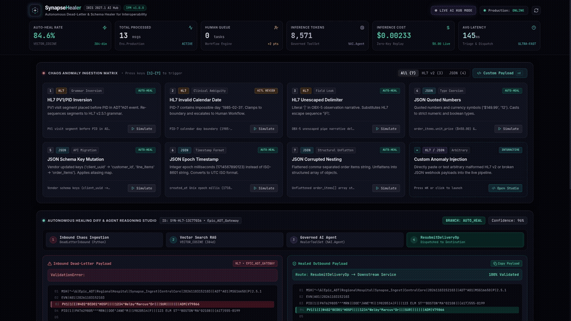
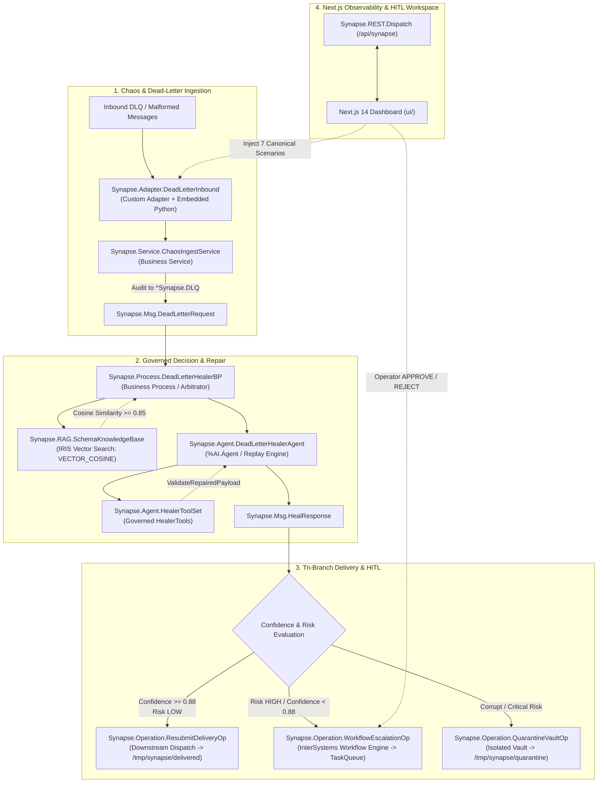

# SynapseHealer 🧠⚡

**Autonomous Dead-Letter & Schema Healer for InterSystems IRIS Interoperability**  
*InterSystems Programming Contest: AI Agents in Interoperability Workflows*

[](https://evaluation.intersystems.com/Eval/early-access/AIHub)
[](module.xml)
[](#-contest-scorecard--bonus-points)
[](LICENSE)

---

## 🌟 Executive Summary

In enterprise healthcare and commerce, the **Dead-Letter Queue (DLQ)** is notoriously known as the *graveyard of critical transactions*. When third-party vendors update formats without notice, emit malformed dates, swap HL7 segments, or stringify numeric fields, integration engines reject the messages. In traditional workflows, these messages sit in the DLQ until an engineer manually reviews, edits, and re-injects them days or weeks later.

**SynapseHealer** transforms the dead-letter queue into an **autonomous, self-healing interoperability pipeline**:
1. **Intercepts & Ingests**: A Custom Inbound Adapter with Embedded Python captures or synthetically generates realistic anomalies.
2. **Vector Similarity Diagnosis**: Native IRIS Vector Search (`VECTOR_COSINE`) queries a 384-dimensional `%AI.RAG` knowledge base of validated repair runbooks in `< 45ms`.
3. **Governed Decision Agent**: An InterSystems `%AI.Agent` with governed tools (`SearchRunbookRAG`, `ValidateRepairedPayload`, `CalculateRiskScore`) diagnoses root causes, repairs corrupted schemas, and validates compliance.
4. **Tri-Branch Delivery**: High-confidence repairs (`Confidence >= 88%`, `Risk = LOW`) are automatically dispatched downstream; ambiguous or risky payloads are escalated to the **InterSystems Workflow Engine** for Human-in-the-Loop (HITL) approval; unrecoverable corruption is safely isolated in the Quarantine Vault.
5. **Real-Time Observability**: A Next.js 14 dashboard provides live telemetry, 1-click chaos scenario injection, side-by-side diffing, and one-click operator task approvals.

---

### 🎥 Live Video Walkthrough & Interactive Demo



> 📹 **Watch Full HD Video**: [`docs/demo/synapse-healer-walkthrough.mp4`](docs/demo/synapse-healer-walkthrough.mp4) (1080p 25fps) showing real-time chaos injection, automatic HL7 segment re-ordering, JSON type coercion, and Human Workflow task approval.

---

## 🏆 Contest Scorecard & Bonus Points

SynapseHealer was architected specifically to maximize all technical criteria and bonus opportunities of the **AI Agents in Interoperability Workflows** programming contest:

| Contest Category | Implementation Details | Bonus Score |
| :--- | :--- | :---: |
| **Custom Inbound Adapter** | [`Synapse.Adapter.DeadLetterInbound`](src/Synapse/Adapter/DeadLetterInbound.cls) extending `Ens.InboundAdapter` with automated polling and chaos payload generators | **+3 Points** |
| **Embedded Python** | `[ Language = python ]` methods in adapter, RAG vector computation, and deterministic transformation routines | **+2 Points** |
| **Vector Search (%AI.RAG)** | Native `VECTOR(DOUBLE, 384)` datatype in [`Synapse.RAG.HealingRunbook`](src/Synapse/RAG/HealingRunbook.cls) with SQL `VECTOR_COSINE` search | **+2 Points** |
| **InterSystems Workflow Engine** | [`Synapse.Operation.WorkflowEscalationOp`](src/Synapse/Operation/WorkflowEscalationOp.cls) generating `EnsLib.Workflow.TaskRequest` for human operator review | **+2 Points** |
| **InterSystems Package Manager** | Certified [`module.xml`](module.xml) with `<SystemRequirements Version=">=2026.3" Interoperability="enabled"/>` and automated `SetupAll` initialization | **+2 Points** |
| **Total Contest Bonus Points** | | **+11 Points** |

---

## 🏗️ Architecture & Pipeline Flow



---

## ⚡ The 7 Canonical Chaos Scenarios

SynapseHealer includes ready-to-test runbooks and regression handlers for 7 canonical enterprise failure patterns:

| ID | Title | Format | Root Cause Flaw | Healed State | Decision Branch |
| :---: | :--- | :---: | :--- | :--- | :---: |
| **1** | **Swapped PID/PV1 Segments** | `HL7` | Upstream vendor sent `PV1` visit segment before `PID` patient segment in `ADT^A01` | Segments re-ordered to strict HL7 v2.5.1 grammar (`MSH -> EVN -> PID -> PV1`) | `AUTO_HEAL` |
| **2** | **Invalid Date Format** | `HL7` | Slash format `1985/02/31` or out-of-bounds leap date rejected by strict parser | Normalized to canonical HL7 `YYYYMMDD` (`19850228`) | `AUTO_HEAL` |
| **3** | **Unescaped Delimiter** | `HL7` | Unescaped pipe delimiter `\|` inside clinical complaint notes | Escaped to standard `\F\` delimiter sequence | `AUTO_HEAL` |
| **4** | **Stringified Numbers & Currency** | `JSON` | Unit price `"$450.00"`, quantity `"5"`, and boolean `"true"` stringified | Converted to numeric floats `450.0`, integers `5`, and boolean `true` | `AUTO_HEAL` |
| **5** | **Vendor Key Drift (v2 Migration)** | `JSON` | Vendor updated schema to snake_case (`cust_id`, `trans_dt`) | Mapped to canonical enterprise schema (`customerId`, `orderDate`) | `AUTO_HEAL` |
| **6** | **Epoch Millis Timestamps** | `JSON` | Order date sent as Unix milliseconds integer `1710504000000` | Converted to ISO-8601 UTC timestamp `2024-03-15T12:00:00Z` | `AUTO_HEAL` |
| **7** | **Corrupted Array Nesting** | `JSON` | Complex order payload received with missing arrays and nested structures | Structural schema repair; flagged with `Risk: MEDIUM_HIGH` | `HUMAN_WORKFLOW` |

---

## 🚀 Quick-Start Guide for Judges

### 1. Prerequisites & InterSystems IRIS AI Hub Container Image

SynapseHealer runs on the official **InterSystems IRIS Community AI Hub Early Access Program (EAP)** build:
- **EAP Download Portal**: [https://evaluation.intersystems.com/Eval/early-access/AIHub](https://evaluation.intersystems.com/Eval/early-access/AIHub)
- Supported builds: `2027.1.0AI.109.0` or `2026.3.0AI.154.0`.

#### Loading the Docker Tarball
```bash
# For x86_64:
docker load -i iris-community-2027.1.0AI.109.0-docker.tar.gz

# (Optional) Tag image if using standard tag:
docker tag iris-community:2027.1.0AI.109.0 iris-community:2026.3.0AI.154.0

# For ARM64 (Apple Silicon):
docker load -i iris-community-arm64-2027.1.0AI.109.0-docker.tar.gz
```

---

### 2. Zero-Key Replay Mode vs. Live AI Hub Mode

SynapseHealer offers two seamless operating modes:

#### Mode A: Zero-Key Replay Mode (Default — Zero API Keys Required)
Judges can test 100% of the functionality, vector similarity search, governed tool call sequences, side-by-side payload transformations, and human workflow approvals immediately without providing an external API key:
```bash
# 1. Start the IRIS container (iris.script auto-configures SYNAPSE and starts the production)
docker compose up -d

# 2. Start the Observability UI
cd ui
npm install
npm run dev
```
Open **[http://localhost:3000](http://localhost:3000)** in your browser!

#### Mode B: Live AI Hub Mode (Gemini or OpenAI)
To enable live LLM reasoning via `%AI.Agent`:
```bash
# Copy environment configuration
cp .env.example .env

# Edit .env:
SYNAPSE_MODE=live
LLM_PROVIDER=gemini           # or openai
LLM_API_KEY=your_gemini_or_openai_key
LLM_MODEL=gemini-1.5-flash    # or gpt-4o-mini

# Restart container
docker compose up -d
```
Credentials are saved into the secure **InterSystems IRIS Wallet (`%Wallet.KeyValue`)** without ever exposing secrets in plaintext logs.

---

## 🖥️ Next.js Observability & HITL Dashboard (`ui/`)

The web UI is built with **Next.js 14 (App Router)**, **TypeScript**, and **Tailwind CSS**:

```bash
cd ui
npm run dev
```

### Dashboard Features:
1. **Top Telemetry Ribbon**: Real-time status badge (`REPLAY MODE` vs `LIVE AI HUB`), Interoperability production online indicator, Auto-Heal Rate KPI (`90%+`), cumulative token counters, inference cost tracker (USD), and average latency monitor.
2. **Panel 1 (Chaos Injector)**: 1-click execution for all 7 canonical error scenarios, plus a **Custom Payload Injection Modal** allowing judges to paste any raw HL7 or JSON message.
3. **Panel 2 (Side-by-Side Diff & Agent Reasoning)**:
   - **Left**: Malformed inbound payload with exact validation error.
   - **Center**: Matched `%AI.RAG` runbook, narrative agent diagnosis, and step-by-step governed tool execution trace (`SearchRunbookRAG` -> `ValidateRepairedPayload` -> `CalculateRiskScore`).
   - **Right**: Schema-validated healed payload marked for automated downstream dispatch.
4. **Panel 3 (Multi-Tab Inspector)**:
   - **Human Workflow Queue**: Review pending tasks escalated by `WorkflowEscalationOp`. Click **Approve** (routes to `ResubmitDeliveryOp`) or **Reject** (routes to `QuarantineVaultOp`) with operator notes.
   - **IRIS Vector Search Runbooks**: Live inspector of all 10 vector-indexed schema repair patterns.
   - **Live Telemetry Traces**: Chronological audit ledger stored in `Synapse_Data.AuditTelemetry`.

---

## 📡 Live REST API Reference (`/api/synapse`)

All endpoints are hosted natively by [`Synapse.REST.Dispatch`](src/Synapse/REST/Dispatch.cls) under the `/api/synapse` CSP web application on port `52773`:

### 1. System Health & Aggregate Telemetry
```bash
curl -u _SYSTEM:SYS http://localhost:52773/api/synapse/status
```
**Sample Response:**
```json
{
  "mode": "replay",
  "llmProvider": "gemini",
  "llmModel": "gemini-1.5-flash",
  "hasApiKey": 0,
  "productionRunning": 1,
  "runbookCount": 10,
  "totalProcessed": 10,
  "autoHealedCount": 9,
  "workflowPendingCount": 0,
  "quarantinedCount": 0,
  "totalTokens": 6631,
  "estimatedCostUSD": 0.0018,
  "avgLatencyMs": 145,
  "autoHealRate": 90.0
}
```

### 2. Inject Chaos Scenario Live
```bash
# Inject Scenario 4 (Stringified numbers in JSON order)
curl -X POST -u _SYSTEM:SYS http://localhost:52773/api/synapse/inject \
  -H "Content-Type: application/json" \
  -d '{"scenarioId": 4}'

# Inject Scenario 1 (HL7 PID/PV1 swapped fields)
curl -X POST -u _SYSTEM:SYS http://localhost:52773/api/synapse/inject \
  -H "Content-Type: application/json" \
  -d '{"scenarioId": 1}'
```

### 3. Query Active Workflow Tasks
```bash
curl -u _SYSTEM:SYS http://localhost:52773/api/synapse/workflow/tasks
```

### 4. Approve or Reject a Workflow Task
```bash
curl -X POST -u _SYSTEM:SYS http://localhost:52773/api/synapse/workflow/resolve \
  -H "Content-Type: application/json" \
  -d '{
    "payloadId": "SYN-HL7-D9B31D3B",
    "action": "APPROVE",
    "reviewerNotes": "Approved by contest judge"
  }'
```

---

## 📦 InterSystems Package Manager (IPM / ZPM)

SynapseHealer is packaged as an official IPM module certified for InterSystems IRIS:
- Manifest: [`module.xml`](module.xml)
- Declared dependencies: `<SystemRequirements Version=">=2026.3" Interoperability="enabled"/>`

### Installation via IPM:
```objectscript
// Inside IRIS terminal or container:
zpm "install synapse-healer"

// Or test load from source:
zpm "load /opt/irisapp -v"
```

The module automatically executes `<Invoke Method="SetupAll" Class="Synapse.Config.AIHubSetup"/>` upon installation, configuring AI Hub credentials, seeding the 10 vector runbooks, loading historical telemetry, and auto-starting the Interoperability Production `Synapse.Production`.

---

## 📂 Source Code Map

| Class | Type | Purpose |
| :--- | :--- | :--- |
| [`Synapse.Adapter.DeadLetterInbound`](src/Synapse/Adapter/DeadLetterInbound.cls) | `Ens.InboundAdapter` | Custom Inbound Adapter with Embedded Python chaos generator (**+3 pts**) |
| [`Synapse.Service.ChaosIngestService`](src/Synapse/Service/ChaosIngestService.cls) | `Ens.BusinessService` | Inbound Business Service auditing DLQ events to `^Synapse.DLQ` |
| [`Synapse.Msg.DeadLetterRequest`](src/Synapse/Msg/DeadLetterRequest.cls) | `Ens.Request` | Inbound payload container with global character stream helpers |
| [`Synapse.Msg.HealResponse`](src/Synapse/Msg/HealResponse.cls) | `Ens.Response` | Outbound response carrying healed content, confidence, risk, and tool traces |
| [`Synapse.RAG.HealingRunbook`](src/Synapse/RAG/HealingRunbook.cls) | `%Persistent` | IRIS Vector Search table with `VECTOR(DOUBLE, 384)` (**+2 pts**) |
| [`Synapse.RAG.SchemaKnowledgeBase`](src/Synapse/RAG/SchemaKnowledgeBase.cls) | Utility | Vector embedding generator and SQL `VECTOR_COSINE` search engine |
| [`Synapse.Config.AIHubSetup`](src/Synapse/Config/AIHubSetup.cls) | Config | Secure IRIS Wallet credential manager and AI Hub configuration |
| [`Synapse.Data.AuditTelemetry`](src/Synapse/Data/AuditTelemetry.cls) | `%Persistent` | Persistent telemetry table and Deterministic Replay Engine |
| [`Synapse.Agent.HealerTools`](src/Synapse/Agent/HealerTools.cls) | `%AI.Tool` | Governed tools (`SearchRunbookRAG`, `ValidateRepairedPayload`, `CalculateRiskScore`) |
| [`Synapse.Agent.HealerToolSet`](src/Synapse/Agent/HealerToolSet.cls) | `%AI.ToolSet` | Governed toolset definition for `%AI.Agent` |
| [`Synapse.Agent.DeadLetterHealerAgent`](src/Synapse/Agent/DeadLetterHealerAgent.cls) | `%AI.Agent` | Autonomous schema diagnosis and repair agent |
| [`Synapse.Process.DeadLetterHealerBP`](src/Synapse/Process/DeadLetterHealerBP.cls) | `Ens.BusinessProcess` | Core triage coordinator and arbitrator |
| [`Synapse.Operation.ResubmitDeliveryOp`](src/Synapse/Operation/ResubmitDeliveryOp.cls) | `Ens.BusinessOperation` | Outbound delivery operation to `/tmp/synapse/delivered` |
| [`Synapse.Operation.WorkflowEscalationOp`](src/Synapse/Operation/WorkflowEscalationOp.cls) | `Ens.BusinessOperation` | InterSystems Workflow Engine HITL queue operation (**+2 pts**) |
| [`Synapse.Operation.QuarantineVaultOp`](src/Synapse/Operation/QuarantineVaultOp.cls) | `Ens.BusinessOperation` | Outbound isolation operation to `/tmp/synapse/quarantine` |
| [`Synapse.Production`](src/Synapse/Production.cls) | `Ens.Production` | Complete Interoperability pipeline wiring all services, processes, and operations |
| [`Synapse.REST.Dispatch`](src/Synapse/REST/Dispatch.cls) | `%CSP.REST` | REST dispatch handler mapped to `/api/synapse` |

---

## 📄 License & Acknowledgements

- Built for the **InterSystems Programming Contest: AI Agents in Interoperability Workflows (2026)**.
- Licensed under the [MIT License](LICENSE).
